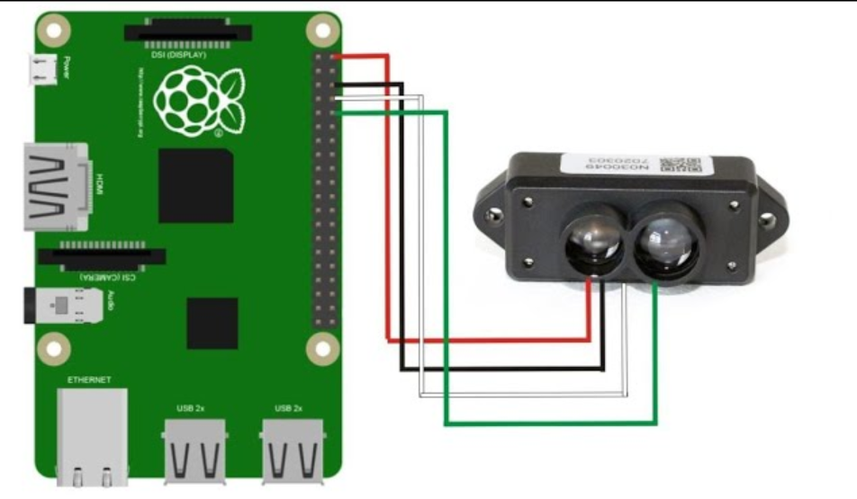

# Robot Desmalezador - Capstone

**=== Ejecución RPLidar A1 ===**

**T1**
```
ros2 run rplidar_ros rplidar_node --ros-args -p serial_port:=/dev/ttyUSB0 -p serial_baudrate:=115200 -p frame_id:=laser_link -p angle_compensate:=true
```
**T2**
```
python3 cf_deteccion_troncos.py
```


**=== Ejecución MAPIR ===**

**T1**
```
python3 mapir_publisher.py
```
**T2**
```
python3 procesamiento_nir.py
```


**=== Ejecución TF-Mini ===**

**T1**
```
ros2 run sensado driver_tfmini
```
**T2**
```
ros2 run sensado procesamiento_tfmini
```

<figure>
  <figcaption><b>Conexiones TF-Mini to RPi4</b></figcaption>
  
</figure>

**STM32 Connection**
A3 (naranjo) to Pin24
A2 (rojo) to Pin21

**=== Simulación Rutina de Navegación ===**
```
cd {RUTA_HACIA_EL_PROYECTO}

colcon build --packages-select sensado

source install/setup.bash

ros2 launch sensado sim.launch.py

```

**=== Ejecutar Rutina de Navegación ===**
```
ssh g4@192.168.1.246
pass: 12345678

cd ros2_ws/Robot-Desmalezador---Capstone

colcon build --symlink-install
source install/setup.bash

ros2 launch sensado real_rutina.launch.py distancia_meta:=0.70 meta_arboles:=4 tiempo_delay_brazo:=1.0 tiempo_brazo_extendido:=4.0 

```
