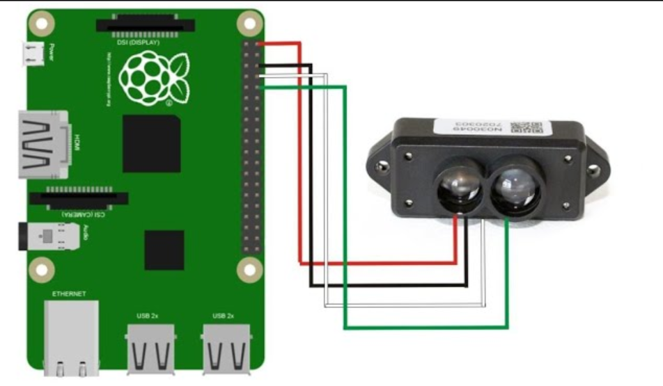

# Robot Desmalezador - Capstone

**=== Ejecución RPLidar A1 ===**

**T1**
```
ros2 run rplidar_ros rplidar_node --ros-args -p serial_port:=/dev/ttyUSB0 -p serial_baudrate:=115200 -p frame_id:=laser_link -p angle_compensate:=true
```
**T2**
```
python3 cf_deteccion_troncos.py
```


**=== Ejecución MAPIR ===**

**T1**
```
python3 mapir_publisher.py
```
**T2**
```
python3 procesamiento_nir.py
```


**=== Ejecución TF-Mini ===**

**T1**
```
ros2 run sensado driver_tfmini
```
**T2**
```
ros2 run sensado procesamiento_tfmini
```

<figure>
  <figcaption><b>Conexiones TF-Mini to RPi4</b></figcaption>
  
</figure>

**STM32 Connection**
A3 (naranjo) to Pin24
A2 (rojo) to Pin21

**=== Simulación Rutina de Navegación ===**
```
cd {RUTA_HACIA_EL_PROYECTO}

colcon build --packages-select sensado

source install/setup.bash

ros2 launch sensado sim.launch.py

```

**=== Ejecutar Rutina de Navegación ===**
```
ssh g4@192.168.1.246
pass: 12345678

cd ros2_ws/Robot-Desmalezador---Capstone

colcon build --symlink-install
source install/setup.bash

ros2 launch sensado real_rutina.launch.py distancia_meta:=0.70 meta_arboles:=4 tiempo_delay_brazo:=1.0 tiempo_brazo_extendido:=4.0 

```

**=== Calibración Manual MAPIR ===**
Para entornos nuevos, ejecutar de forma manual el calibrador de la mapir con un suelo y planta de referencia

```
ros2 run sensado mapir_driver
```
```
ros2 run sensado mapir_calibrador

```

Por defecto, el nodo **mapir_procesamiento_nir.py** corre en modo_umbral := 'hibrido':       
  
  • En cada imagen que captura, calcula automáticamente la mediana de        
  intensidad NIR de la escena (fondo_mediana), que corresponde a la          
  reflectancia del suelo/tierra bajo la iluminación actual. Luego fija el umbral de corte dinámicamente en umbral\_efectivo
  
  • Cualquier planta cuya reflectancia NIR brille al menos +35     
  niveles por encima del suelo actual (y supere el piso mínimo de 150) se    
  segmenta como maleza.
  
  El calibrador **mapir_calibrador.py** separa automáticamente la imagen en dos poblaciones       
  dentro de la ROI:
      • Mediana(fondo): mide el nivel NIR del suelo/tierra que rodea a la    
      planta.
      • P99 (Percentil 99): mide el nivel NIR de las hojas de la planta de
      referencia.
  Con esos dos valores (suelo vs. planta bajo esa luz): 
      • Si ve la planta (P99 - Mediana >= 30), reporta ESCENA CON CONTRASTE
      (posible maleza en vista) y calcula el punto de corte óptimo al 55% del
      camino entre el suelo y la planta (Mediana + 0.55 * (P99 - Mediana)). 
      • Si solo hay suelo (P99 - Mediana < 30), 
      reporta ESCENA UNIFORME y calcula el umbral de
      seguridad 25 puntos por encima del ruido máximo del suelo (P95 + 25).
  Imprime en consola los argumentos listos para copiar en   
  **real_rutina.launch.py**


