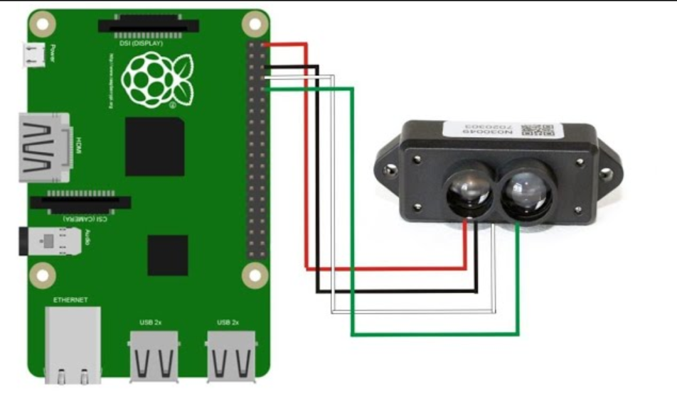

# Robot Desmalezador - Capstone

**=== Ejecución RPLidar A1 ===**

**T1**
```
ros2 run rplidar_ros rplidar_node --ros-args -p serial_port:=/dev/ttyUSB0 -p serial_baudrate:=115200 -p frame_id:=laser_link -p angle_compensate:=true
```
**T2**
```
python3 cf_deteccion_troncos.py
```


**=== Ejecución MAPIR ===**

**T1**
```
python3 mapir_publisher.py
```
**T2**
```
python3 procesamiento_nir.py
```


**=== Ejecución TF-Mini ===**

**T1**
```
ros2 run sensado driver_tfmini
```
**T2**
```
ros2 run sensado procesamiento_tfmini
```

**Conexiones TF-Mini to RPi4**



**=== Simulación Rutina de Navegación ===**
```
cd {RUTA_HACIA_EL_PROYECTO}

colcon build --packages-select sensado

source install/setup.bash

ros2 launch sensado sim.launch.py
```
